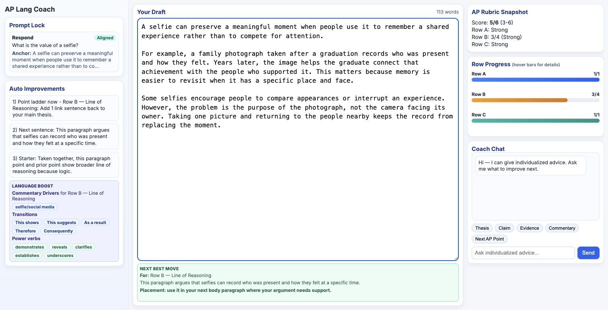

# DraftLoop

**Rubric feedback that gives a student a concrete next revision.**

DraftLoop helps AP English Language students develop an argument and decide what to improve next. Students inspect a six-point rubric snapshot, consider a suggested revision, and discuss the feedback with a teacher. It is a formative coaching prototype; scores still need human judgment.

[See the product walkthrough](docs/WALKTHROUGH.md) · [Read the engineering case study](docs/CASE_STUDY.md) · [Recalculate the recorded results](docs/REPRODUCING.md)

*Actual local app, November 4, 2026. Original synthetic writing; the displayed 5/6 has no human reference score and is excluded from evaluation.*

## What I built

- A Python/FastAPI backend combining model feedback with explicit scoring and review rules.
- A writing workspace connecting thesis, evidence, and sophistication feedback to a next revision, with SQLite storage for classroom feedback.
- An evaluation runner comparing scores with human readers, checking the expected model, and preserving previous reports when a run fails.

## Results

In a three-essay experiment, DraftLoop initially returned incomplete scoring responses. Requiring the scoring fields and allowing longer responses recovered all three complete responses. Exact agreement with human scores remained 0%.

| Recorded sample result | Original | Fixed |
| --- | ---: | ---: |
| Complete scoring responses | 0/3 | 3/3 |
| Exact score agreement | 0% | 0% |
| Agreement within one point | 33.3% | 33.3% |

Three examples cannot establish scoring reliability. The [case study](docs/CASE_STUDY.md) shows each score, explains the failed responses and repair, and identifies the remaining scoring limitations.

## How it works

Essay and prompt → model feedback → Python scoring rules → rubric score, revision guidance, and review reasons.

The model proposes feedback; the application checks and scores it before presenting it to the writer. The [architecture](docs/CASE_STUDY.md#architecture-and-responsibility) shows how this connects to evaluation and classroom feedback storage.

## Explore further

The [product walkthrough](docs/WALKTHROUGH.md) is readable here on GitHub. The [reproduction guide](docs/REPRODUCING.md) explains how to recalculate the recorded metrics locally with no API key or paid service.

This showcase includes recorded results and standalone analysis tools. The complete scoring application remains private. Released essay text is not redistributed; the [source manifest](data/source-manifest.json) identifies the reference material.

Built by [Joshua Cole, PhD](https://github.com/JoshuaColePhD) with AI-assisted development. [Ownership and development approach](docs/CASE_STUDY.md#ownership-and-development-approach) · [Evaluation-only license](LICENSE).
