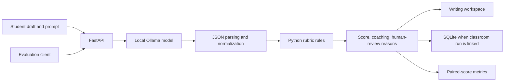

# Complete output is not an accurate score

DraftLoop helps students turn feedback into a revision. That requires two different checks: did the model return the fields the application needs, and did the resulting score agree with a human reader?

## Ownership and development approach

Joshua Cole leads the product and pedagogical direction, including the writing-to-revision workflow and how evaluation findings are interpreted. Development and this portfolio cleanup use AI assistance for implementation, tests, and documentation. The repository presents inspectable artifacts and measured limitations rather than claiming unaided code authorship. The complete application remains private; the small public reanalysis and preparation utilities are evaluation-only.

## Architecture and responsibility

The model proposes rubric fields and coaching text. Python normalizes the response, applies thesis/evidence rules, and computes the six-point total. Thus these results evaluate the combined model-plus-rules system, not the model alone. Row A covers thesis (0–1), Row B evidence/commentary (0–4), and Row C sophistication (0–1). Local structural heuristics are not equivalent to expert reading.

## The observed failure

The original quick-feedback request capped generation at 80 tokens. Replaying that request on the three reference essays produced `finish_reason=length` for every response before any rubric field appeared. Application fallbacks still produced a score, and all three responses carried an incomplete-rubric review flag.

The repair required structured rubric/coaching fields and increased the Ollama quick-feedback ceiling to 512 tokens. The recorded fixed completions stopped normally at 252, 253, and 245 tokens. Scoring rules, model tag, mode, and the prepared input checksum stayed the same.

| Sample | Human total | Original total | Fixed total | Fixed error |
| --- | ---: | ---: | ---: | ---: |
| 3A | 6 | 4 | 4 | −2 |
| 3B | 4 | 3 | 5 | +1 |
| 3C | 2 | 4 | 4 | +2 |

Completeness improved from 0/3 to 3/3. Human-review flags fell from 3/3 to 0/3. Exact agreement remained 0/3; adjacent agreement remained 1/3; quadratic weighted kappa and Pearson correlation were both 0.000. Sample 3B moved from one point below to one point above the reference score. The other two remained two points away.

**A missing review flag is not a certificate of accuracy.** The fix improved the output contract, while this tiny sample gave no evidence of improved score agreement. A useful next iteration would target the specific over/underscoring mechanisms before making broader performance claims.

## Making the run auditable

The November 3, 2026 record identifies Ollama `llama3.2:3b`, `CLASS_25` mode, and the prepared-input SHA-256. Numeric rows and completeness flags are in [recorded-results.json](../data/recorded-results.json); the official document URL, human row scores, and provenance limits are in [source-manifest.json](../data/source-manifest.json).

The private evaluation client now defaults to that provider/model/mode. It checks health before sending drafts and verifies the identity in every scored response. Unexpected substitution, mid-run changes, invalid scores, or request failures abort without replacing the prior report. These are offline-tested guards, not a new model-quality experiment. The application API is unchanged.

## Limits and trade-offs

- Three intentionally varied released essays cannot estimate real-world reliability, bias, classroom usefulness, or performance on other prompts.
- The original run records a model tag, not an immutable weight digest or full request traces. Numeric reanalysis is exact; generative reruns need not match.
- Structural heuristics may reward conventional paragraph signals and miss implicit or unconventional reasoning.
- The sample has no subgroup labels. No fairness estimate is reported or inferred.
- Local inference avoids hosted API charges but still needs model storage, memory, compute, and time. No latency, cost, or usage-scale claim was measured here.
- The classroom interface uses seeded demo data and lacks production authentication. It is not ready for operational grading.

The screenshot is a separate November 4 product demonstration using original synthetic writing. Its 5/6 score has no human reference and is deliberately excluded from every metric above.
