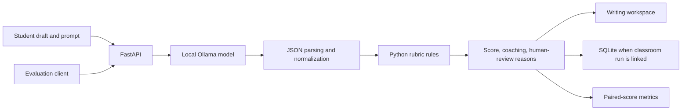

# Fixing incomplete feedback and checking score accuracy

Requiring structured responses recovered complete rubric fields in all three examples. Exact score agreement with human readers remained 0%. This case study follows the failure, the repair, and the limits of what improved.

## The observed failure

The original quick-feedback request capped generation at 80 tokens. Replaying that request on the three reference essays produced `finish_reason=length` for every response before any rubric field appeared. Application fallbacks still produced a score, and all three responses carried an incomplete-rubric review flag.

The repair required structured rubric/coaching fields and increased the Ollama quick-feedback ceiling to 512 tokens. The recorded fixed completions stopped normally at 252, 253, and 245 tokens. Scoring rules, model tag, mode, and the prepared input checksum stayed the same.

| Sample | Human total | Original total | Fixed total | Fixed error |
| --- | ---: | ---: | ---: | ---: |
| 3A | 6 | 4 | 4 | −2 |
| 3B | 4 | 3 | 5 | +1 |
| 3C | 2 | 4 | 4 | +2 |

Completeness improved from 0/3 to 3/3. Human-review flags fell from 3/3 to 0/3. Exact agreement remained 0/3; adjacent agreement remained 1/3; quadratic weighted kappa and Pearson correlation were both 0.000. Sample 3B moved from one point below to one point above the reference score. The other two remained two points away.

**Complete feedback still needs human judgment.** The repair improved response completeness, while this sample gave no evidence of improved score agreement. The next iteration should investigate the specific over- and underscoring mechanisms.

## Architecture and responsibility

The model proposes rubric fields and coaching text. Python normalizes the response, applies thesis/evidence rules, and computes the six-point total. The results therefore evaluate the combined model and scoring rules. Row A covers thesis (0–1), Row B evidence/commentary (0–4), and Row C sophistication (0–1).

## Making the run auditable

The November 3, 2026 record identifies Ollama `llama3.2:3b`, `CLASS_25` mode, and the prepared-input SHA-256. Numeric rows and completeness flags are in [recorded-results.json](../data/recorded-results.json); the official document URL, human row scores, and provenance limits are in [source-manifest.json](../data/source-manifest.json).

The private evaluation client now defaults to that provider/model/mode. It checks health before sending drafts and verifies the identity in every scored response. Unexpected substitution, mid-run changes, invalid scores, or request failures abort without replacing the prior report. Offline tests cover these failure cases; no additional model-quality experiment is claimed.

## Limits and trade-offs

- Three released essays cannot establish real-world reliability, classroom usefulness, or performance on other prompts. There are no subgroup labels to support a fairness comparison.
- The original run records a model tag, not an immutable weight digest or full request traces. Numeric reanalysis is exact; generative reruns may differ.
- Structural scoring rules may reward conventional paragraph signals and miss implicit or unconventional reasoning.
- Local inference avoids hosted API charges but requires storage, memory, compute, and time. This experiment measured no latency, cost, or classroom capacity.
- The classroom interface uses seeded demo data and lacks production authentication. It is not ready for operational grading.

The [archived standalone screenshot](../demo/assets/local-coach.jpg) documents a separate November 4 demonstration with original synthetic writing. Its displayed 5/6 has no human reference score and is excluded from this evaluation. The [current React UI walkthrough](WALKTHROUGH.md) uses explicitly simulated preview feedback and is also excluded.

## Ownership and development approach

Joshua Cole leads the product and pedagogical direction, including the writing-to-revision workflow and interpretation of evaluation findings. Development uses AI assistance for implementation, tests, and documentation. The complete application remains private; the public analysis and preparation utilities carry an evaluation-only license.
