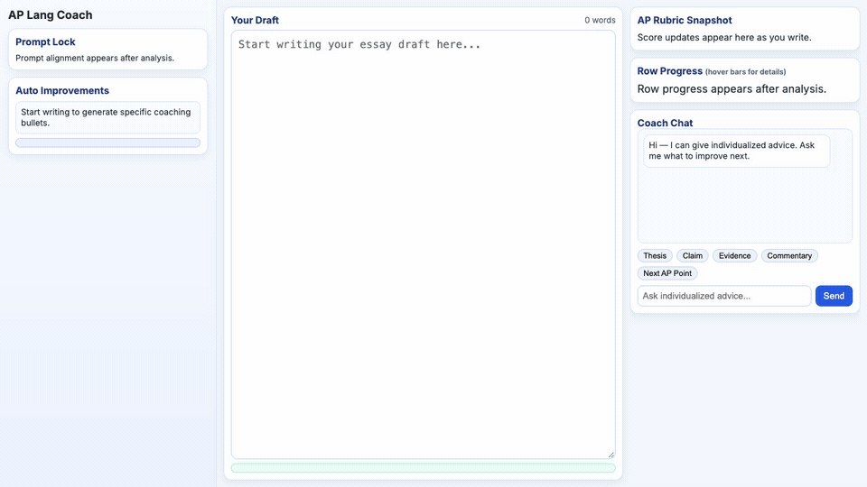
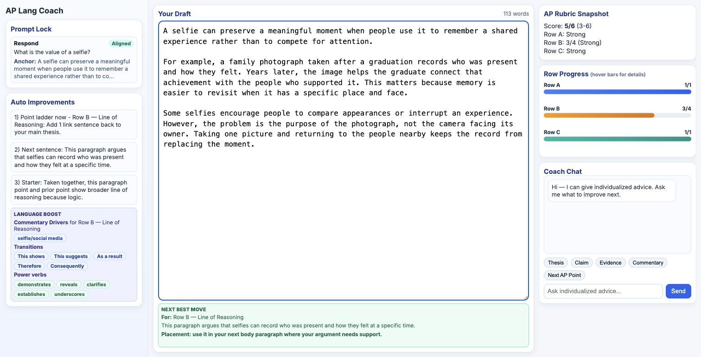

# DraftLoop: from feedback to a next revision

Follow a writer from an initial argument to a specific revision decision.

*Recorded November 5, 2026 with local Ollama `llama3.2:3b`; edited pauses are not a latency measurement. The synthetic score is excluded from evaluation. [Recording details](../demo/RECORDING.md).*

The earlier still below documents the separate November 4 capture.

*Actual local app, November 4, 2026, using Ollama `llama3.2:3b`. Original synthetic writing; the displayed 5/6 has no human reference score and is excluded from evaluation. The 3–6 range is a heuristic, not a calibrated confidence interval.*

## 1. Draft an argument

The writer responds to “What is the value of a selfie?” with a claim about preserving shared memories, a graduation example, and a qualification about distracting comparisons. [Read the synthetic draft and capture details](../data/synthetic-walkthrough.json).

## 2. Inspect the rubric feedback

The interface shows thesis 1/1, evidence/commentary 3/4, and sophistication 1/1. The writer can inspect each row to decide where to focus. These values combine a model proposal with local Python scoring rules.

## 3. Decide on a revision

The coach focuses on the line of reasoning and suggests: “This paragraph argues that selfies can record who was present and how they felt at a specific time.” The writer should decide whether that sentence adds reasoning or simply repeats the paragraph before using it.

[Read the scoring case study](CASE_STUDY.md) for the separate three-essay evaluation, or follow the [optional local walkthrough instructions](REPRODUCING.md#2-view-the-product-walkthrough) to explore the HTML guide.
