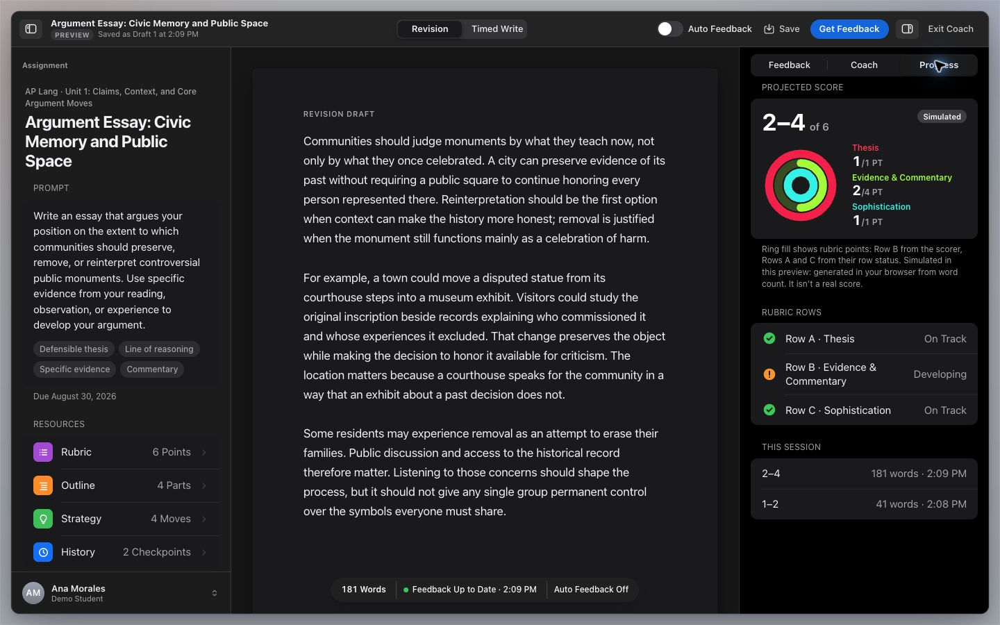

# DraftLoop: from feedback to a next revision

This walkthrough shows the current React Writing Coach at `/student/coach`,
using original synthetic writing and the built-in preview mode.

*Recorded November 5, 2026. Feedback and coach replies are explicitly simulated;
no model calls were made. Displayed ranges and rubric rings are interface examples,
excluded from evaluation. [Recording details](../demo/RECORDING.md).*

## 1. Work from the assignment

The assignment panel asks how communities should preserve, remove, or reinterpret
controversial public monuments. The [original synthetic draft](../data/current-ui-walkthrough.json)
argues for contextualizing monuments or moving them into a museum where needed.

## 2. Inspect feedback and ask the coach

The Feedback panel offers a next revision move. The writer switches to Coach and
asks how to improve commentary. Preview mode labels its browser-generated feedback
and canned reply as **Simulated**; these are not judgments from an AI or a human reader.

## 3. Save and inspect progress

Save Version retains a local checkpoint. The Progress tab shows rubric rings and
session history. Its displayed 2–4 range is a simulated example, not a calibrated
confidence interval or an accuracy result.

[Read the separate scoring case study](CASE_STUDY.md) · [Recalculate recorded metrics](REPRODUCING.md)

The [archived November 4 standalone-coach screenshot](../demo/assets/local-coach.jpg)
and its [Ollama capture record](../data/synthetic-walkthrough.json) document the older interface.
They are separate from this React preview and the three-essay evaluation.
